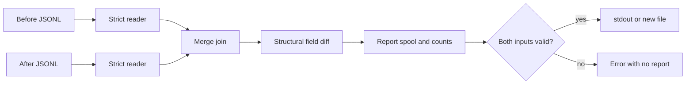

# Architecture and tradeoffs

## Module boundaries

| Module | Responsibility |
| --- | --- |
| `reader.py` | Bounded line reads, exact-number decoding, JSON validation, key order |
| `diff.py` | Recursive structural comparison and JSON Pointer path escaping |
| `merge.py` | One lookahead per sorted input and record-level event classification |
| `report.py` | Deterministic text/JSONL formatting and no-overwrite file publication |
| `__main__.py` | File ownership, report spooling, counts, options, and exit codes |

The merge and diff engines perform no I/O. Direct callers of `reconcile` must
supply sorted unique IDs; the CLI always obtains them from the validating reader.
Direct callers of `differences` should use the JSON types produced by the reader,
including `Decimal` for all numbers. Records are not mutated by comparison.

## Merge and comparison semantics

With lookaheads `a` and `b`, emit removal when `a.id < b.id`, addition when
`b.id < a.id`, or compare matching records. Advance only the consumed side(s).
Once a stream ends, drain the other. This also forces validation of unmatched
records at the ends of the inputs. An unchanged event updates counts but is not
written to a detailed CLI report.

Object order is irrelevant. Arrays compare at their existing indexes rather
than using edit-distance alignment. Adding or removing a whole subtree emits
one path; replacing a type emits one `changed` path. Traversal order is stable
but is not a global lexicographic sort of all final pointer strings.

Both integer and decimal JSON tokens decode to `Decimal`, so exact comparisons
do not silently round a long fraction through a binary float. Numeric spellings
such as `1` and `1.0` compare equal. Type checks keep booleans distinct from
numbers. Explicit exponent magnitude is limited to 1,000,000 before parsing;
leading zeros are removed before the bounded integer conversion and before the
normalized number token reaches Decimal. This avoids
depending on differing exponent limits in Python's decimal backends. Boundary
tests include both signs and exponent encodings with thousands of digits.
`scripts/check_python_decimal.py` runs the core suite with the standard-library
Python fallback in an isolated process, without changing installed interpreters.

JSON Pointer escaping follows [RFC 6901](https://www.rfc-editor.org/rfc/rfc6901).
The report supplies no old/new values and is not an executable patch. IDs and
field names remain visible unless summary-only output is selected.

## Resource use

The merge performs O(N+M) record-level iterations for N and M input records,
assuming bounded key comparison cost. It holds one current record per input.
Field diff work is proportional to visited structure plus sorting object keys,
with O(k log k) sorting for an object having k keys. String/number comparison and
pointer construction also depend on their lengths. These are algorithmic
descriptions, not measured performance claims.

Memory depends on the current records, their structural-validation stacks,
their accumulated field changes, and the report spool buffer; it does not hold
both entire input exports. The 1 MiB physical-line cap and depth cap bound the
size of each record. Generated path strings can be larger than the input record,
and a single report write may temporarily exceed the spool threshold before it
rolls to disk. This is not a hard one-megabyte process-memory guarantee.

The spool spills after 1 MiB. It grows with report size, and file output creates
another temporary copy in the destination directory. Plan for roughly twice the
report size in temporary disk use when writing a large output file. Summary-only
mode avoids accumulating per-record output but still validates every input line.

## Failure and publication behavior

A generator can discover bad input after producing earlier events. Publishing
those events immediately would leave a plausible but incomplete report. The CLI
therefore completes validation and comparison before releasing staged output.
Errors identify the input side and physical line without echoing its contents.

For `--output`, a new sibling temporary file is filled and closed first. A hard
link creates the destination name atomically and fails if it already exists,
including a competing writer's file or a symlink. The temporary name is cleaned
up on success or ordinary exceptions. This requires hard-link support and does
not claim transactional durability across machine crashes or filesystem failure.
Input file contents are not locked; concurrent modifications can invalidate the
assumption that each export is a stable snapshot.

## Test strategy and interview discussion

An independent set-membership oracle enumerates 16 possible before-ID subsets,
16 after-ID subsets, and 16 modified-value subsets: **4,096 cases**. It checks
event classification and order without sharing the production merge algorithm.
Structural symmetry checks invert added/removed paths over small JSON values.
Targeted tests cover high-precision numbers, boolean distinctions, escaped paths,
stream laziness, late validation errors, write failure cleanup, and destination
creation by a competing writer. Large-report testing exercises the spool path.

Useful discussion topics: sorted-input requirements versus external sorting,
one-record lookahead versus whole-file dictionaries, exact decimals versus
floats, and why validation-before-publication consumes temporary disk. Possible
future work includes explicit ignore-path policies, externally sorted imports,
and schema-aware array keys. None is implemented. Describe AI assistance and
subsequent personal review accurately.
